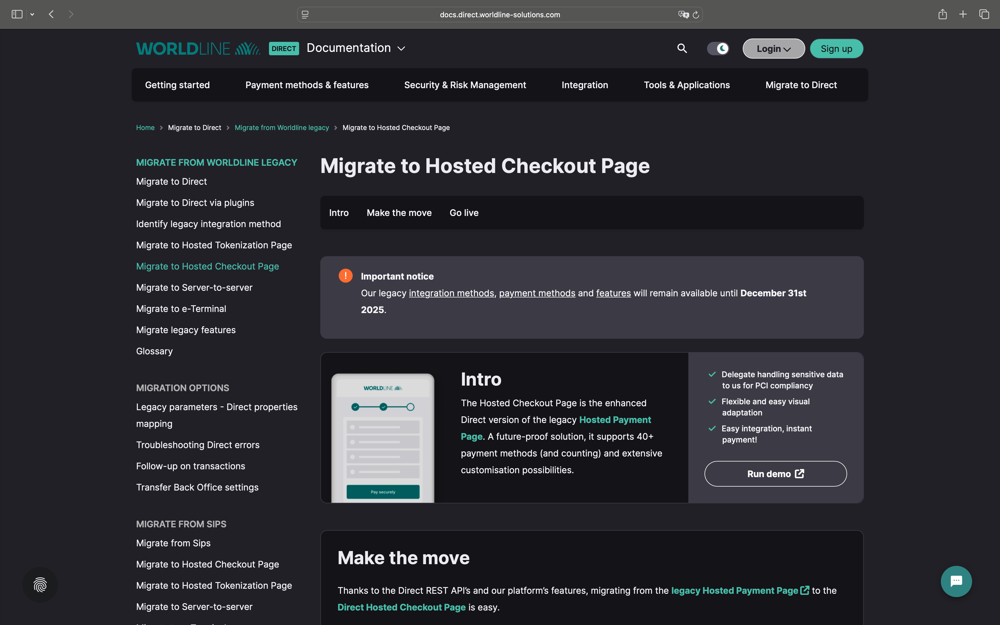

# Deprecated

An important notice from Worldline, the current owner and operator of the Ogone and Ingenico solutions:

> [!IMPORTANT]  
> Our legacy [integration methods](https://support.legacy.worldline-solutions.com/en/integration-solutions/), [payment methods](https://support.legacy.worldline-solutions.com/en/payment-methods/ "nav.payment_methods") and [features](https://support.legacy.worldline-solutions.com/en/security/fraud-prevention/fraud-expert-scoring) will remain available until **December 31st 2025**.

For merchants looking to migrate from the legacy Ogone or Ingenico integrations, we recommend using the [**Worldline – Direct – Hosted Checkout** integration](https://github.com/pronamic/pronamic-pay-worldline-direct-hosted-checkout) included in [Pronamic Pay Premium](https://www.pronamic.shop/product/pronamic-pay-premium/). This integration provides a secure and modern payment experience for WordPress and WooCommerce, ensuring compatibility with current Worldline services and continued support beyond December 31, 2025.
